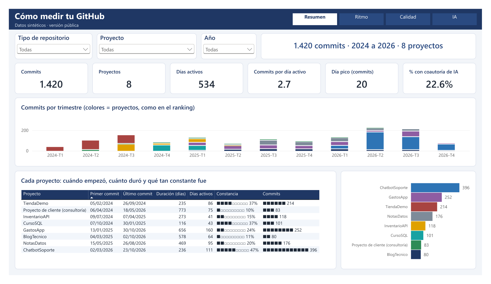
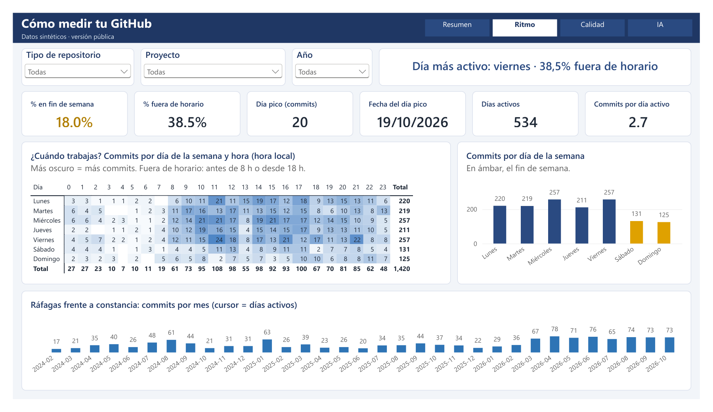
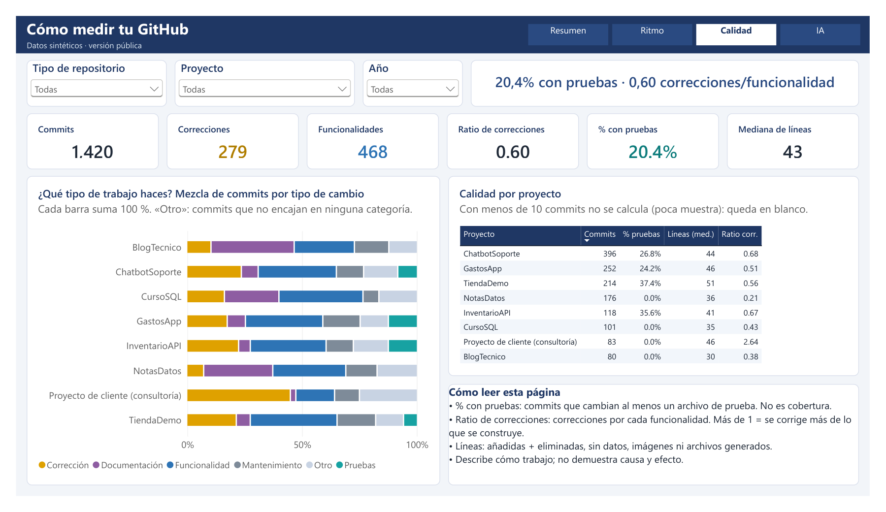
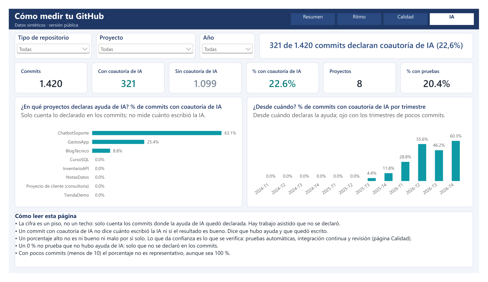

# Cómo medir tu GitHub

Un informe de Power BI para entender **cómo trabajas** a partir de tus commits: cuándo, con qué constancia, qué tipo de cambios haces y cuánto declaras haber usado IA. Incluye el extractor (Python + GitHub CLI) para generar los datos de tu propia cuenta.

> **Los datos de este repositorio son sintéticos.** Los proyectos, fechas y cifras son inventados para poder explorar el informe sin exponer la actividad de nadie.

## Qué mide, y qué no
El informe tiene cuatro páginas:

| Página | Pregunta que responde |
|---|---|
| **Resumen** | ¿Cuántos commits, en qué proyectos y con qué constancia? |
| **Ritmo** | ¿Cuándo trabajo (día y hora)? ¿Trabajo en ráfagas o de forma sostenida? |
| **Calidad** | ¿Qué tipo de trabajo hago? ¿Toco pruebas? ¿Cuánto corrijo frente a lo que construyo? |
| **IA** | ¿En cuántos commits declaré ayuda de IA y desde cuándo? |

**Medir no es juzgar.** Los commits no miden productividad ni calidad. La cifra de IA es un **piso**: solo cuenta los commits donde la herramienta dejó su firma (`Co-Authored-By`), y un 0 % no prueba que no hubo ayuda. Los porcentajes de proyectos con menos de 10 commits se dejan en blanco. Cada página explica cómo leerla.

## Vista previa (datos sintéticos)





## Probar el informe con los datos de ejemplo
1. Abre `Como medir tu Github.pbip` con una versión reciente de Power BI Desktop. (Si no abre el formato de proyecto, actívalo en *Archivo > Opciones > Características en vista previa*.)
2. En *Inicio > Transformar datos > Administrar parámetros*, cambia `RutaDatos` por la ruta de la carpeta `Datos` de este repositorio.
3. Pulsa *Actualizar*.

## Usarlo con tus propios datos
Necesitas [GitHub CLI](https://cli.github.com) y Python 3.9 o superior. No hay tokens en ningún archivo: el script usa tu sesión de `gh`.

```bash
gh auth login        # una sola vez
python extraer_actividad_github.py --usuario TU-USUARIO --repos repo-1 repo-2 repo-3 --salida Datos_reales
```

Opciones útiles:

| Opción | Para qué sirve |
|---|---|
| `--anonimo propietario/repo=alias` | Incluir un repositorio de terceros con un alias; su nombre real nunca se escribe en la salida. Se puede repetir. |
| `--utc-offset -5` | Tu zona horaria (por defecto UTC-5). |
| `--desde 2022` | Año inicial del calendario de contribuciones. |
| `--completo` | Ignorar la caché y recalcular todo. |

Después apunta `RutaDatos` a `Datos_reales` y pulsa *Actualizar*.

**Carga incremental.** El detalle de cada commit (archivos y líneas) se guarda en `.cache_detalle.json`; las siguientes ejecuciones solo consultan los commits nuevos. Si GitHub responde con límite de llamadas (5.000 por hora), el avance se conserva: vuelve a ejecutar el mismo comando más tarde.

**Calidad de la extracción.** Cada ejecución escribe `calidad_extraccion.csv` y resume en pantalla las verificaciones (por ejemplo, commits obtenidos frente al total que reporta GitHub). Si algo dice `REVISAR`, no confíes en las cifras hasta entenderlo.

## Privacidad
Los archivos de salida contienen solo conteos, fechas, horas y clasificaciones: sin mensajes de commits, nombres de archivos, correos ni nombres de personas. Aun así, **revisa tus CSV antes de publicarlos**. La carpeta `Datos_reales/` y la caché están en el `.gitignore`.

## Licencia
[MIT](LICENSE): puedes usar, copiar y modificar el código, incluido el modelo del informe, conservando el aviso de copyright.

## Contenido
- `Como medir tu Github.pbip`, `.SemanticModel`, `.Report`: el informe y su modelo (formato de proyecto de Power BI).
- `extraer_actividad_github.py`: extractor de tus datos reales.
- `generar_datos_sinteticos.py`: genera los datos de ejemplo (semilla fija).
- `Datos/`: CSV sintéticos y [`DICCIONARIO.md`](Datos/DICCIONARIO.md), con cada columna y los límites de interpretación.
